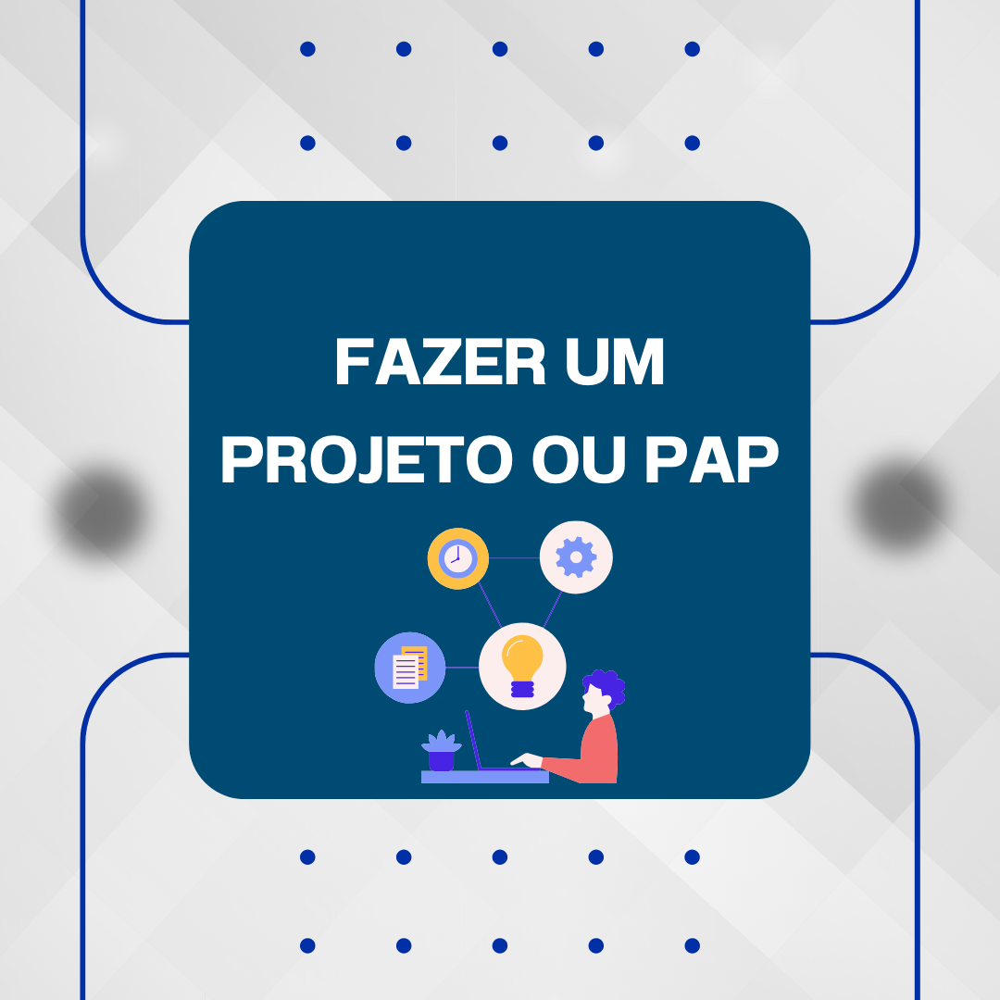
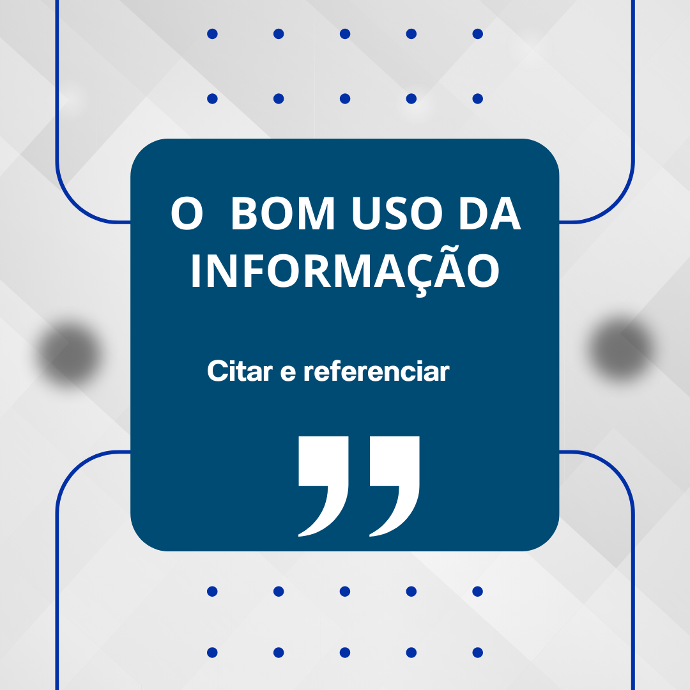
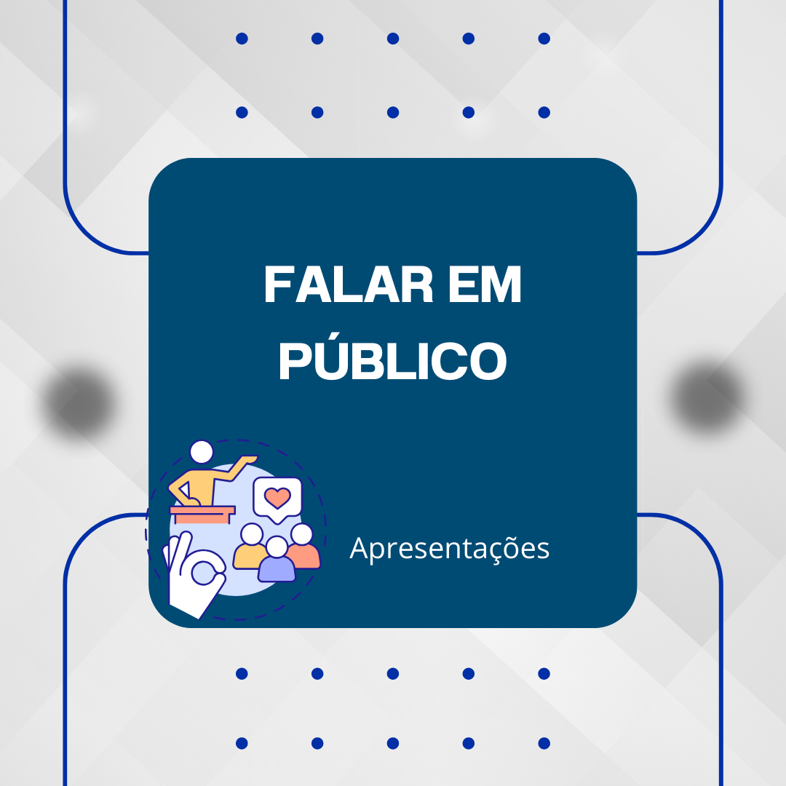
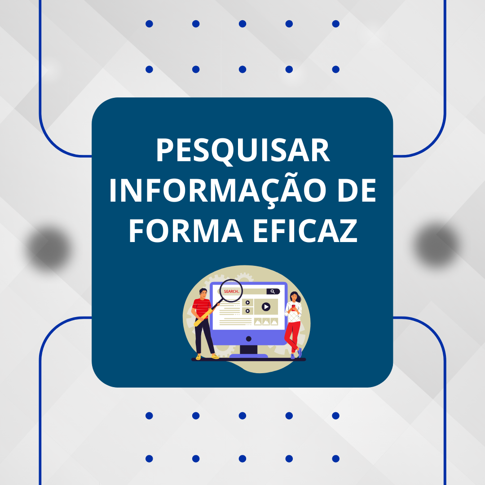
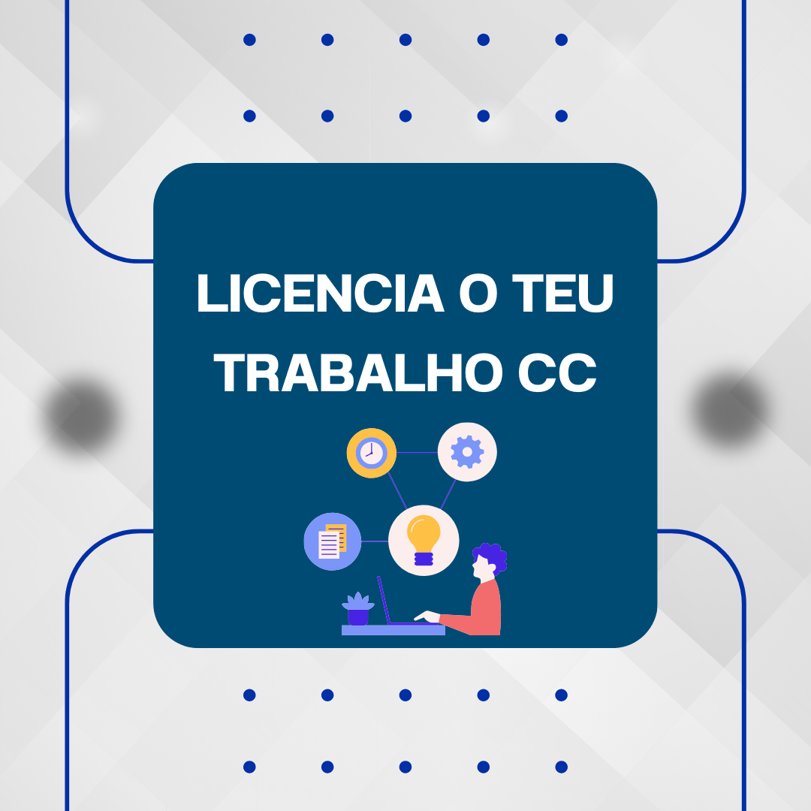
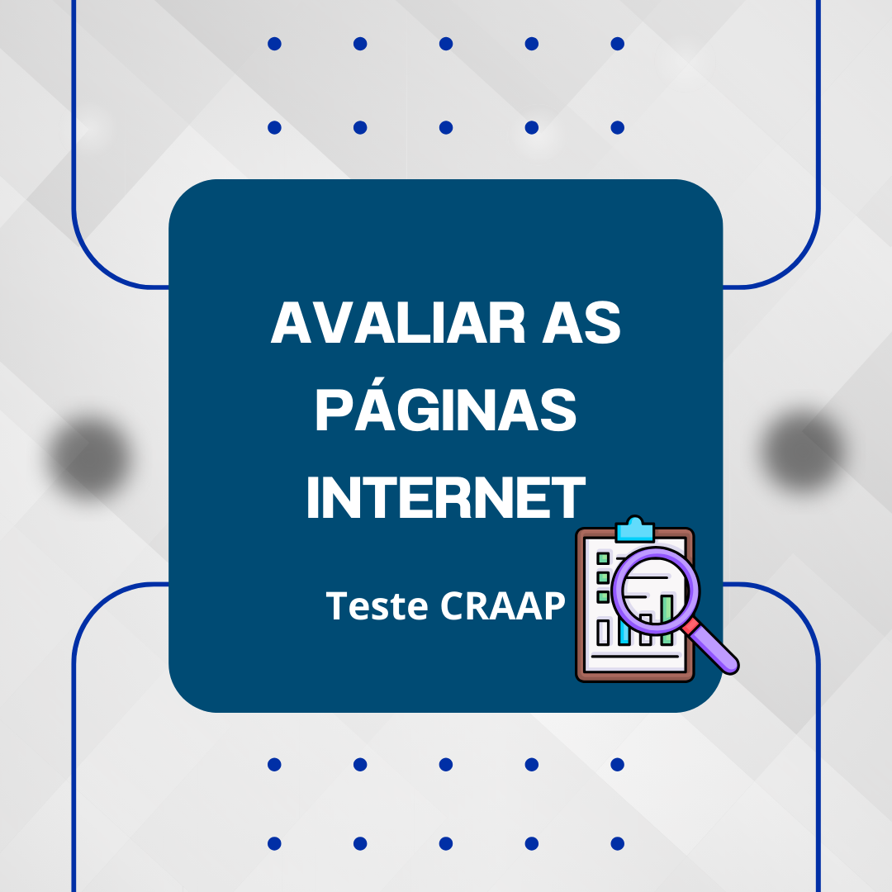
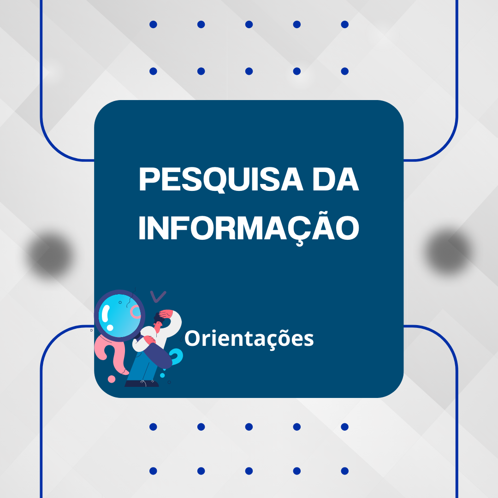

# BEESAP - Apoio à Aprendizagem

Fonte: arquivo de `gs_apoio-_C3_A0-aprendizagem.html` (recolhido em 2026-11-12)

---

Site ESAP [https://www.esap.edu.pt/]

Blogue BEESAP [https://ler-o-mundo-na-beesap.webnode.pt/]

Site ESAP [https://www.esap.edu.pt/]

Blogue BEESAP [https://ler-o-mundo-na-beesap.webnode.pt/]

Site ESAP [https://www.esap.edu.pt/]

Blogue BEESAP [https://ler-o-mundo-na-beesap.webnode.pt/]

Recursos Estudo em Casa [https://estudoemcasaapoia.dge.mec.pt/recurso/como-fazer-um-projeto-ou-pap]

[https://www.canva.com/design/DAGGKcRqxdA/YpK2M5cK3yGkguE-3I0Szg/view?utm_content=DAGGKcRqxdA&utm_campaign=designshare&utm_medium=link&utm_source=editor]

[https://www.canva.com/design/DAGGhsHc9Hc/PPsNU04OwLaJ2VWi7fssFw/view?utm_content=DAGGhsHc9Hc&utm_campaign=designshare&utm_medium=link&utm_source=editor]

[https://mild.rbe.mec.pt/pesquisas-informacao-de-forma-eficaz/]

Para saber procurar, navegar e avaliar informação em linha. [https://mild.rbe.mec.pt/pesquisas-informacao-de-forma-eficaz/]

[https://chooser-beta.creativecommons.org/]

Partilha o teu trabalho com as Licenças Creative Commons [https://chooser-beta.creativecommons.org/]

[https://acrobat.adobe.com/id/urn:aaid:sc:EU:01162149-992f-436b-9640-d9d78089322a]

Grelha de verificação para avaliar criticamente a informação [https://acrobat.adobe.com/id/urn:aaid:sc:EU:01162149-992f-436b-9640-d9d78089322a]

[https://literacia-da-informacao1.webnode.pt/pesquisadainformacao/]

Familiariza-te com as licenças Creative Commons

Literacia da informação :: Aprender-digital-RBEAs práticas de literacia da informação visam dotar os alunos de conhecimentos que os capacitem para o acesso, produção e uso crítico da informação e para uma comunicação eficaz, ética e socialmente responsável. O aluno procura, avalia criticamente e trata os dados, atendendo à credibilidade das fontes e respeitando princípios éticos e normativos. A... [https://aprender-digital8.webnode.pt/literacia-da-informacao/]

Identificar Temas e problemas [https://aprender-digital8.webnode.pt/identificar-temas-problemas/]

Tratar a informação [https://aprender-digital8.webnode.pt/tratar-a-informacao/]

Produzir [https://aprender-digital8.webnode.pt/produzir2/]

Literacia dos media :: Aprender-digital-RBEAs práticas de literacia dos media visam dotar os alunos de conhecimentos necessários para o seu uso criativo e informado. O aluno usa os media e espaços sociais de interação e comunicação de forma ética e responsável para produzir, comunicar e participar civicamente. A biblioteca escolar cria condições de acesso e oportunidades de aprendizagem,... [https://aprender-digital8.webnode.pt/literacia-dos-media/]

Conhecer [https://aprender-digital8.webnode.pt/conhecer/]

Refletir [https://aprender-digital8.webnode.pt/refletir/]

Produzir [https://aprender-digital8.webnode.pt/produzir/]

Literacia da leitura :: Aprender-digital-RBEA literacia da leitura inclui o uso, reflexão e compreensão de textos multimodais. Integra também o domínio de diferentes formas de expressão: oral, escrita e multimédia. O aluno lê e comunica, explorando conteúdos e situações para responder aos seus gostos, interesses e necessidades. Trabalhar a leitura e as literacias a ela associadas, num... [https://aprender-digital8.webnode.pt/literacia-da-leitura/]

Ler [https://aprender-digital8.webnode.pt/ler/]

Compreender [https://aprender-digital8.webnode.pt/compreender/]

Falar/ Escrever/ Apresentar [https://aprender-digital8.webnode.pt/falar-escrever/]

Recursos - 3º Ciclo [https://www.aprendizinvestigador.pt/recursos]

Aprendiz de Investigador

Literacias na Escola

Recursos - Secundário [https://www.aprendizinvestigador.pt/recursos]

Aprendiz de Investigador

Literacias na Escola

Recursos Professores [https://www.aprendizinvestigador.pt/recursos]

Aprendiz de Investigador

Literacias na Escola

A wikipédia

Saber tudo acerca das licenças creative commons? A Wikipédia [https://pt.wikipedia.org/wiki/Licen%C3%A7as_Creative_Commons] sabe!

Escola Secundária Adolfo Portela

Rua Joaquim Valente Almeida, 242

3750-154 ÁGUEDA

Telefone: 234 623 808

---

## Conteúdos incorporados

- https://maps-api-ssl.google.com/maps?hl=en-US&ll=40.583891,-8.447763&output=embed&q=40.583714,-8.447813&z=16

## Ligações

- https://www.esap.edu.pt/
- https://ler-o-mundo-na-beesap.webnode.pt/
- https://estudoemcasaapoia.dge.mec.pt/recurso/como-fazer-um-projeto-ou-pap
- https://www.canva.com/design/DAGGKcRqxdA/YpK2M5cK3yGkguE-3I0Szg/view?utm_content=DAGGKcRqxdA&utm_campaign=designshare&utm_medium=link&utm_source=editor
- https://www.canva.com/design/DAGGhsHc9Hc/PPsNU04OwLaJ2VWi7fssFw/view?utm_content=DAGGhsHc9Hc&utm_campaign=designshare&utm_medium=link&utm_source=editor
- https://mild.rbe.mec.pt/pesquisas-informacao-de-forma-eficaz/
- https://chooser-beta.creativecommons.org/
- https://acrobat.adobe.com/id/urn:aaid:sc:EU:01162149-992f-436b-9640-d9d78089322a
- https://literacia-da-informacao1.webnode.pt/pesquisadainformacao/
- https://aprender-digital8.webnode.pt/literacia-da-informacao/
- https://aprender-digital8.webnode.pt/identificar-temas-problemas/
- https://aprender-digital8.webnode.pt/tratar-a-informacao/
- https://aprender-digital8.webnode.pt/produzir2/
- https://aprender-digital8.webnode.pt/literacia-dos-media/
- https://aprender-digital8.webnode.pt/conhecer/
- https://aprender-digital8.webnode.pt/refletir/
- https://aprender-digital8.webnode.pt/produzir/
- https://aprender-digital8.webnode.pt/literacia-da-leitura/
- https://aprender-digital8.webnode.pt/ler/
- https://aprender-digital8.webnode.pt/compreender/
- https://aprender-digital8.webnode.pt/falar-escrever/
- https://www.aprendizinvestigador.pt/recursos
- https://pt.wikipedia.org/wiki/Licen%C3%A7as_Creative_Commons

## Imagens

