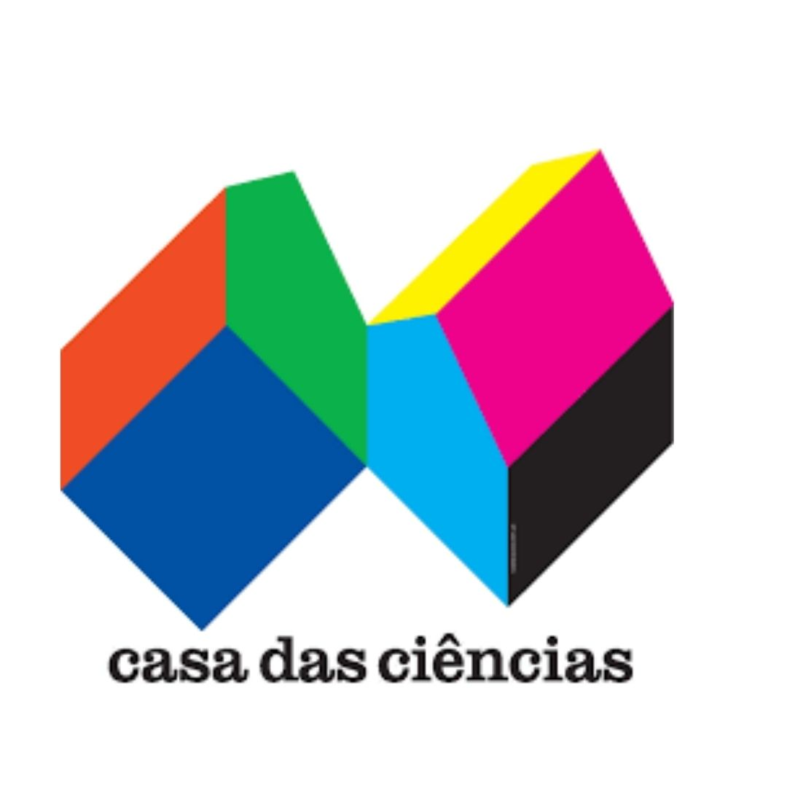

# BEESAP - Bancos de imagens

Fonte: arquivo de `gs_ferramentas-tutoriais_bancos-de-imagens.html` (recolhido em 2026-11-12)

---

Site ESAP [https://www.esap.edu.pt/]

Blogue BEESAP [https://ler-o-mundo-na-beesap.webnode.pt/]

Site ESAP [https://www.esap.edu.pt/]

Blogue BEESAP [https://ler-o-mundo-na-beesap.webnode.pt/]

Site ESAP [https://www.esap.edu.pt/]

Blogue BEESAP [https://ler-o-mundo-na-beesap.webnode.pt/]

Gratuitos

[https://www.casadasciencias.org/banco-imagens]

Várias categorias - Ciências [https://www.casadasciencias.org/banco-imagens]

[https://getrefe.com/downloads/category/free/]

[https://www.freepik.es/]

Recursos gráficos [https://www.freepik.es/]

[https://www.rawpixel.com/public-domain]

[https://www.rgbstock.com/]

[https://pixabay.com/pt/]

[https://unsplash.com/s/photos/free]

[https://www.reshot.com/]

[https://www.pexels.com/pt-br/licenca/]

Baixar música gratuitamente [https://www.jamendo.com/?language=pt]

[https://commons.wikimedia.org/wiki/P%C3%A1gina_principal?uselang=pt]

Coleção de 86,545,340 aquivos [https://commons.wikimedia.org/wiki/Special:Statistics] (imagens, sons e vídeos)

[https://www.flickr.com/]

Escola Secundária Adolfo Portela

Rua Joaquim Valente Almeida, 242

3750-154 ÁGUEDA

Telefone: 234 623 808

---

## Conteúdos incorporados

- https://maps-api-ssl.google.com/maps?hl=en-US&ll=40.583891,-8.447763&output=embed&q=40.583714,-8.447813&z=16

## Ligações

- https://www.esap.edu.pt/
- https://ler-o-mundo-na-beesap.webnode.pt/
- https://www.casadasciencias.org/banco-imagens
- https://getrefe.com/downloads/category/free/
- https://www.freepik.es/
- https://www.rawpixel.com/public-domain
- https://www.rgbstock.com/
- https://pixabay.com/pt/
- https://unsplash.com/s/photos/free
- https://www.reshot.com/
- https://www.pexels.com/pt-br/licenca/
- https://www.jamendo.com/?language=pt
- https://commons.wikimedia.org/wiki/P%C3%A1gina_principal?uselang=pt
- https://commons.wikimedia.org/wiki/Special:Statistics
- https://www.flickr.com/

## Imagens

