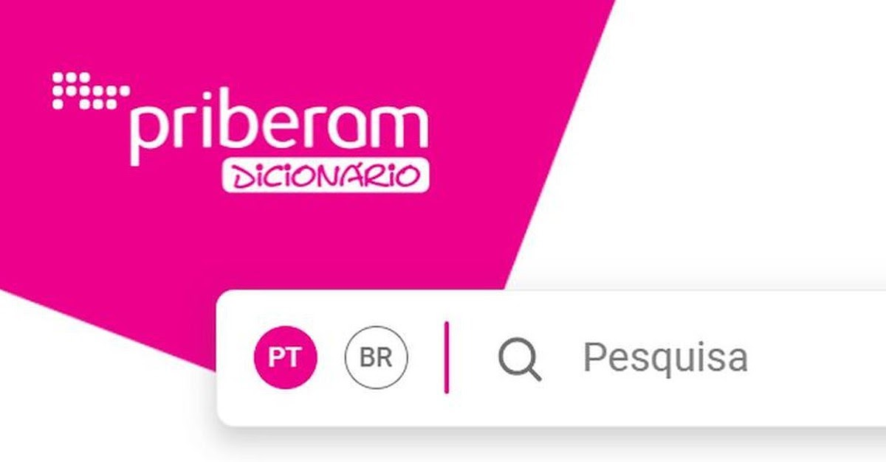
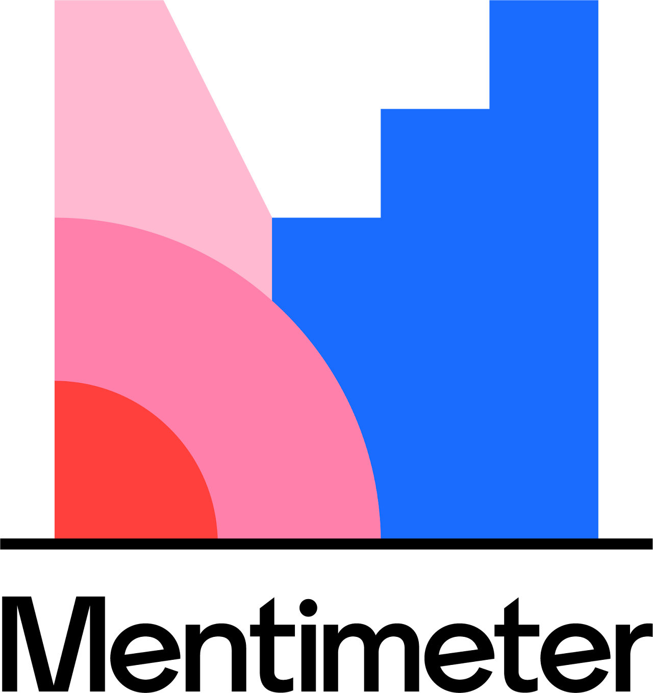
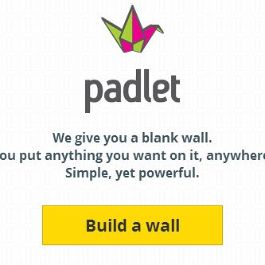
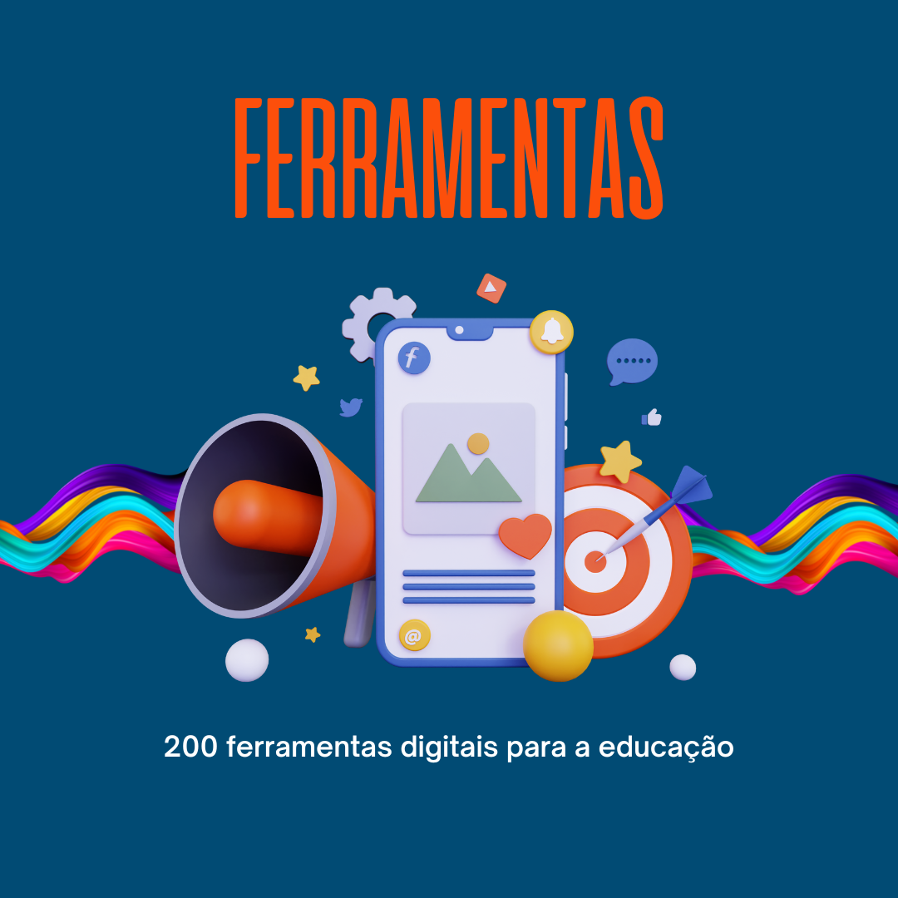
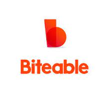

# BEESAP - Ferramentas & Tutoriais

Fonte: arquivo de `gs_ferramentas-tutoriais.html` (recolhido em 2026-11-12)

---

Site ESAP [https://www.esap.edu.pt/]

Blogue BEESAP [https://ler-o-mundo-na-beesap.webnode.pt/]

Site ESAP [https://www.esap.edu.pt/]

Blogue BEESAP [https://ler-o-mundo-na-beesap.webnode.pt/]

Site ESAP [https://www.esap.edu.pt/]

Blogue BEESAP [https://ler-o-mundo-na-beesap.webnode.pt/]

## Ferramentas &

## Tutoriais

[https://www.pressreader.com/catalog]

Jornais e revistas online (várias línguas) [https://www.pressreader.com/catalog]

Segue este tutorial para saberes tudo sobre o tratamento de imagens.

[https://zbib.org/]

Ferramenta [https://zbib.org/] que gera a tua bibliografia de forma rápida. A norma adotada na ESAP é a APA7th.

[https://dicionario.priberam.org/]

O Dicionário Priberam da Língua [https://dicionario.priberam.org/] Portuguesa (DPLP) é um dicionário online [https://dicionario.priberam.org/] de português.

[https://www.deepl.com/pt-PT/translator]

Tradutor Deepl [https://www.deepl.com/pt-PT/translator]

[https://www.storyboardthat.com/pt]

Criar Banda Desenhada [https://www.storyboardthat.com/pt]

Banco de imagens [https://br.freepik.com/]

Criar designs variados [https://www.canva.com/]

Banco de imagem [https://pixabay.com/pt/]

[https://www.educaplay.com/resource-editor/]

Portal para criar atividades educativas [https://www.educaplay.com/resource-editor/]

Tutorial Laura Chagas [https://youtu.be/LfRyLcvyLVI]

[https://learningapps.org/]

LearningApps [https://learningapps.org/] é uma aplicação Web 2.0 que permite criar, consolidar e aprender, com exercícios diversos e gamificação, sustentando o processo de ensino e aprendizagem.

Tutorial de Adelina Moura [https://youtu.be/rPHfuPyXsEA]

[https://www.mentimeter.com/]

Plataforma online para criação e compartilhamento de apresentações de slides com interatividade.

Tutorial de Adelina Moura [https://youtu.be/XJHodjfUcfo]

[https://auth.genial.ly/signup]

Produção/Edição Media [https://youtu.be/-jCnIxqs_FU] Software de criação de conteúdo interativo. Permite criar imagens, infográficos, apresentações, microsites, catálogos, mapas, entre outros, que podem ser dotados de efeitos e animações interativos.

Tutorial de Inês Rodrigues [https://youtu.be/-jCnIxqs_FU]

[https://padlet.com/]

Colpadlet.com/ [https://padlet.com/] ecionar, organizar, partilhar e apresentar

[https://www.educatech.pt/thinglink-a-interatividade-nas-nossas-maos/]

Thinglink [https://www.thinglink.com/scene/415540713166471170]

É uma ferramenta que permite conferir interatividade a imagens e vídeos.

Tutorial de Adelina Moura [https://youtu.be/8PdXYiTl6jM]

[https://wakelet.com/]

Wakelet [https://wakelet.com/]

É uma ferramenta de mural gratuita que permite organizar e partilhar informação em vários formatos (texto, PDF, ficheiros do Drive, imagem, URL, Youtube, tweets...).

Tutorial: Criar mural digital [https://youtu.be/cYnHYg_EoY8]

Tutorial: Criar um mural digital em espaço partilhado [https://youtu.be/U8ZLvxyGa4w]

Tutorial: [https://youtu.be/cYnHYg_EoY8]Editar, partilhar e colaborar. [https://youtu.be/hxrFX7FOybg]

[https://digital-rbe-d01.blogspot.com/]

Instrumentos e tutoriais da RBE [https://digital-rbe-d01.blogspot.com/]

[https://linhadeleitura.wordpress.com/ferramentas-digitais-para-educacao/]

Linha de Leitura [https://linhadeleitura.wordpress.com/]

Um blogue de leitura e literacia

[https://edpuzzle.com/]

Tutorial [https://youtu.be/X1jXf8pfPHo]

Cria vídeos com questionários e é uma forma interativa de sala de aula invertida.

[https://biteable.com/]

Biteable [https://biteable.com/]

Permite fazer vídeos criativo

Tutorial de RobotNTIC [https://youtu.be/lvGenRd2okg]

Tutorial [https://youtu.be/UTVzkW51onQ]

Fazer Vídeos criativo

Escola Secundária Adolfo Portela

Rua Joaquim Valente Almeida, 242

3750-154 ÁGUEDA

Telefone: 234 623 808

---

## Conteúdos incorporados

- https://maps-api-ssl.google.com/maps?hl=en-US&ll=40.583891,-8.447763&output=embed&q=40.583714,-8.447813&z=16

## Ligações

- https://www.esap.edu.pt/
- https://ler-o-mundo-na-beesap.webnode.pt/
- https://www.pressreader.com/catalog
- https://zbib.org/
- https://dicionario.priberam.org/
- https://www.deepl.com/pt-PT/translator
- https://www.storyboardthat.com/pt
- https://br.freepik.com/
- https://www.canva.com/
- https://pixabay.com/pt/
- https://www.educaplay.com/resource-editor/
- https://youtu.be/LfRyLcvyLVI
- https://learningapps.org/
- https://youtu.be/rPHfuPyXsEA
- https://www.mentimeter.com/
- https://youtu.be/XJHodjfUcfo
- https://auth.genial.ly/signup
- https://youtu.be/-jCnIxqs_FU
- https://padlet.com/
- https://www.educatech.pt/thinglink-a-interatividade-nas-nossas-maos/
- https://www.thinglink.com/scene/415540713166471170
- https://youtu.be/8PdXYiTl6jM
- https://wakelet.com/
- https://youtu.be/cYnHYg_EoY8
- https://youtu.be/U8ZLvxyGa4w
- https://youtu.be/hxrFX7FOybg
- https://digital-rbe-d01.blogspot.com/
- https://linhadeleitura.wordpress.com/ferramentas-digitais-para-educacao/
- https://linhadeleitura.wordpress.com/
- https://edpuzzle.com/
- https://youtu.be/X1jXf8pfPHo
- https://biteable.com/
- https://youtu.be/lvGenRd2okg
- https://youtu.be/UTVzkW51onQ

## Imagens

