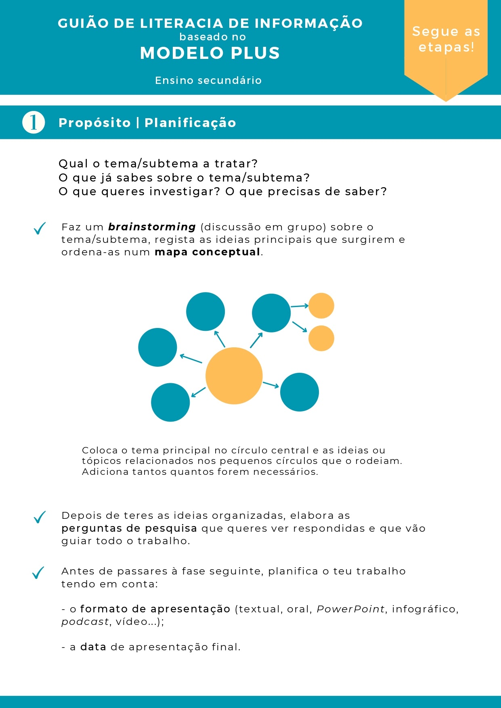
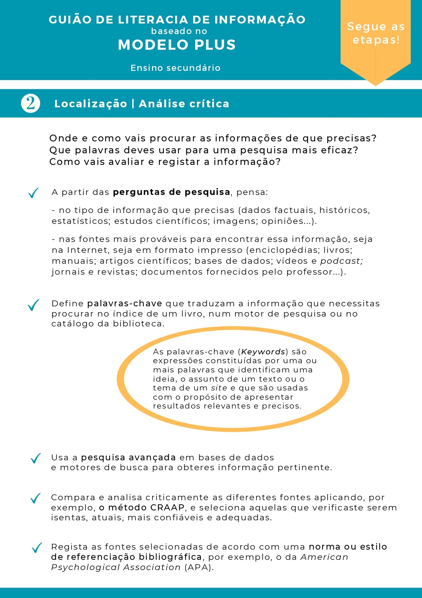
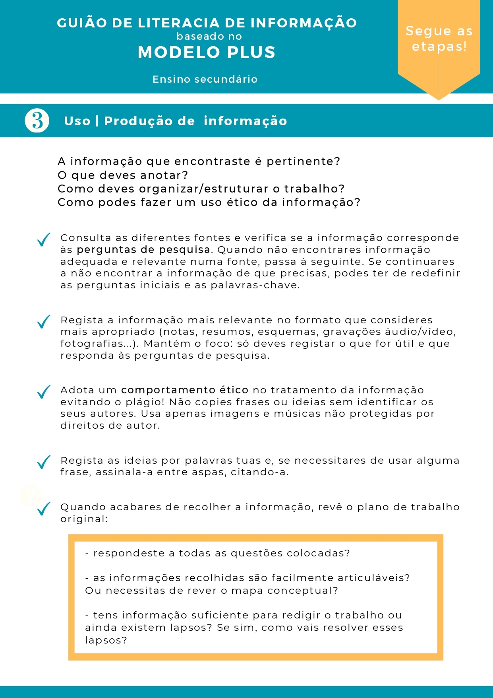
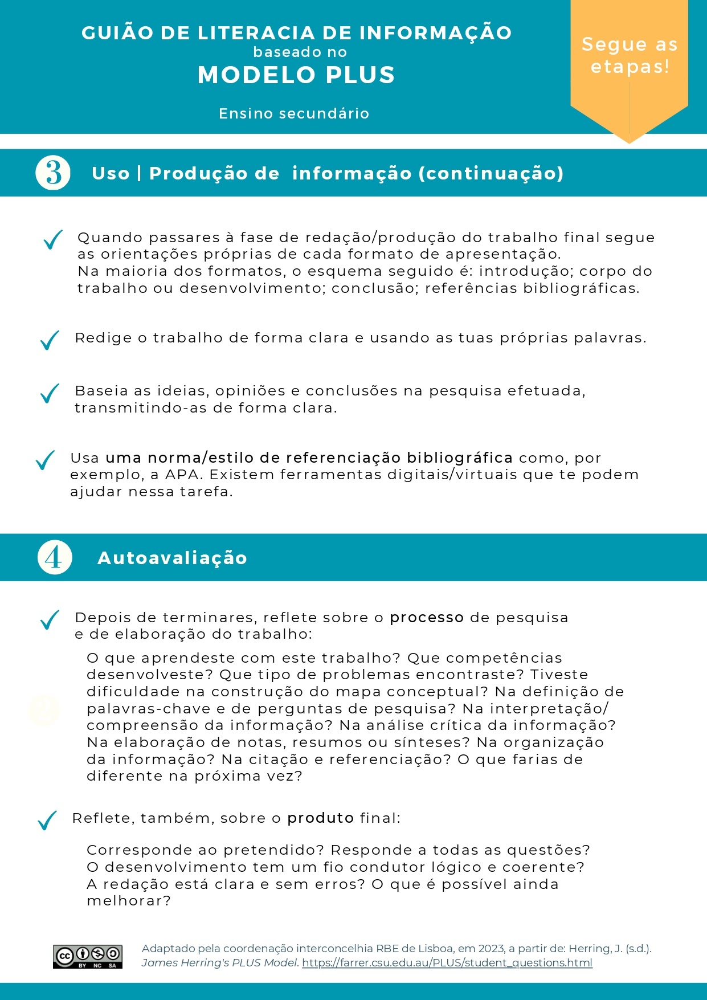

# BEESAP - Guião de pesquisa

Fonte: arquivo de `gs_gui_C3_A3o-de-pesquisa.html` (recolhido em 2026-11-12)

---

Site ESAP [https://www.esap.edu.pt/]

Blogue BEESAP [https://ler-o-mundo-na-beesap.webnode.pt/]

Site ESAP [https://www.esap.edu.pt/]

Blogue BEESAP [https://ler-o-mundo-na-beesap.webnode.pt/]

Site ESAP [https://www.esap.edu.pt/]

Blogue BEESAP [https://ler-o-mundo-na-beesap.webnode.pt/]

Escola Secundária Adolfo Portela

Rua Joaquim Valente Almeida, 242

3750-154 ÁGUEDA

Telefone: 234 623 808

---

## Conteúdos incorporados

- https://maps-api-ssl.google.com/maps?hl=en-US&ll=40.583891,-8.447763&output=embed&q=40.583714,-8.447813&z=16

## Ligações

- https://www.esap.edu.pt/
- https://ler-o-mundo-na-beesap.webnode.pt/

## Imagens

