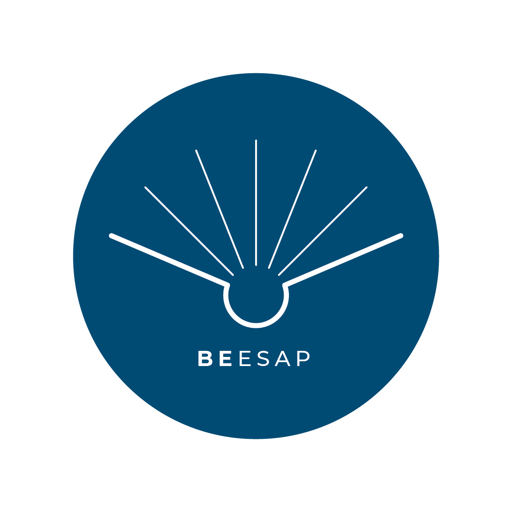

# BEESAP - Quem somos?

Fonte: arquivo de `gs_informa_C3_A7_C3_B5es_quem-somos.html` (recolhido em 2026-11-12)

---

Site ESAP [https://www.esap.edu.pt/]

Blogue BEESAP [https://ler-o-mundo-na-beesap.webnode.pt/]

Site ESAP [https://www.esap.edu.pt/]

Blogue BEESAP [https://ler-o-mundo-na-beesap.webnode.pt/]

Site ESAP [https://www.esap.edu.pt/]

Blogue BEESAP [https://ler-o-mundo-na-beesap.webnode.pt/]

Equipa:

Coordenadora da Biblioteca Escolar: Regina Gaspar

Assistente Técnica: Cláudia Santos

Professores: Gorete Correia, Isabel Amaro e Jorge Henriques

Escola Secundária Adolfo Portela

Rua Joaquim Valente Almeida, 242

3750-154 ÁGUEDA

Telefone: 234 623 808

---

## Conteúdos incorporados

- https://maps-api-ssl.google.com/maps?hl=en-US&ll=40.583891,-8.447763&output=embed&q=40.583714,-8.447813&z=16

## Ligações

- https://www.esap.edu.pt/
- https://ler-o-mundo-na-beesap.webnode.pt/

## Imagens

