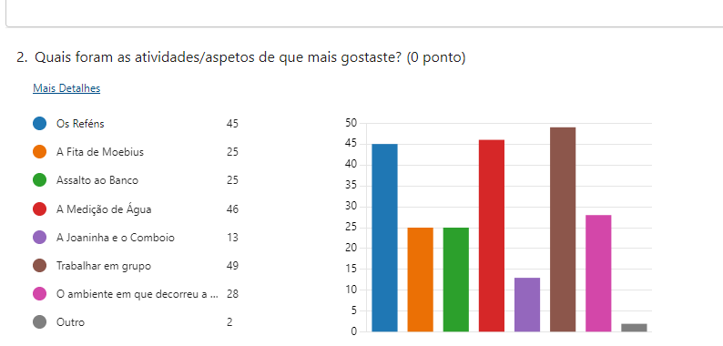
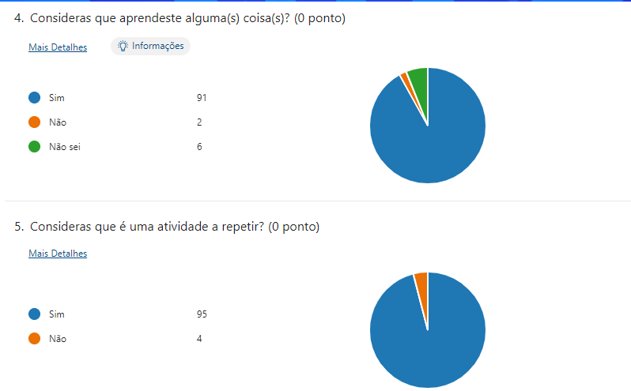
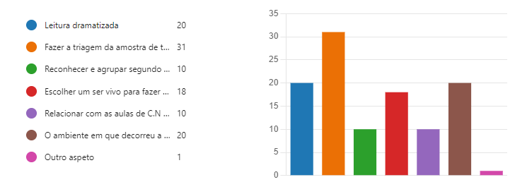
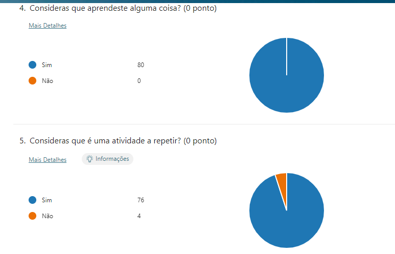
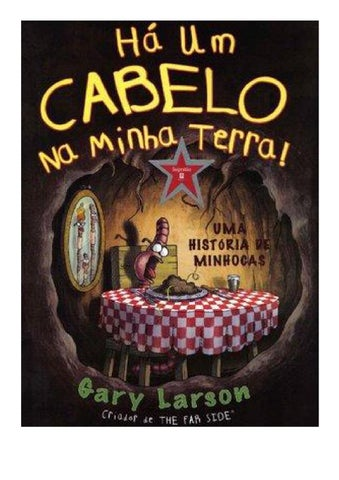
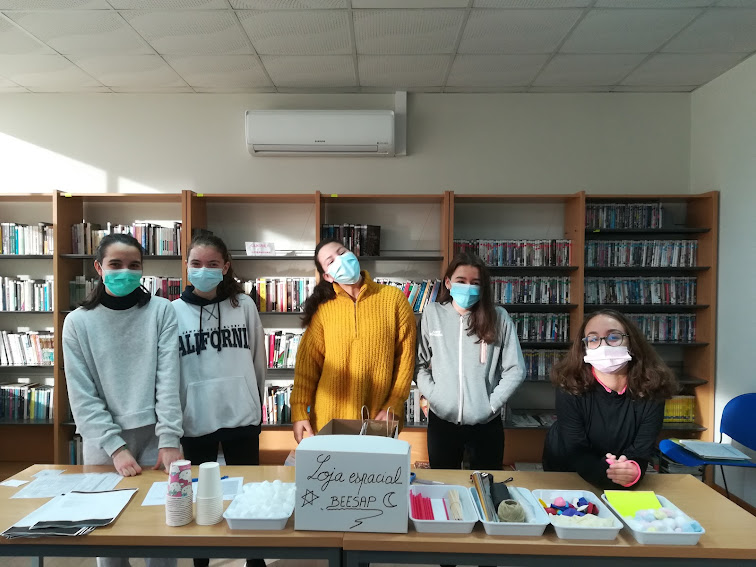

# Newton Gostava de Ler :: Ler o Mundo Na BEESAP

Fonte: arquivo de `wn_newton-gostava-de-ler.html` (recolhido em 2026-11-12)

---

Biblioteca Escolar da Escola Secundária Adolfo Adolfo Portela

## Enigmatemático

Há já uma semana que terminaram as sessões do Projeto Newton

Gostava de Ler, no módulo chamado Enigmatemático. Não se pretende que a

matemática seja apenas divertida, mas mostrar que a matemática está em tudo na

nossa vida diária, todos os dias fazemos apelo a conhecimentos matemáticos em

ações quotidianas.

Melhor falam todos os alunos de todos os 7º anos que

passaram pela BEESAP e realizaram as tarefas em grupo. Aqui ficam os resultados

do questionário a que responderam.

As três atividades mais plebiscitadas por eles são, por

ordem de preferência, a Medição da Água e Os Reféns. Sublinham também que

gostaram do ambiente em que trabalharam e o desafio de resolver problemas em

grupo.

Se sentem que aprenderam com esta atividade? A grande

maioria diz ter aprendido algo e dizem ser uma atividade a repetir.

Como vai sendo habitual, deixo aqui algumas palavras no

discurso direto:

Porque

achei divertido e de certa forma toda a gente aprendeu.

É

porque estás atividades são importantes para o desenvolvimento das mentes dos

alunos

Porque

gostei da atividade e achei uma experiência divertida.

Porque

ajuda-nos a fazer o nosso raciocínio ir mais além.

Podemos

aprender que a matemática não é só números e que está presente no nosso dia a

dia em diversas situações :)

Porque

ajuda-nos a crescer em todos os aspetos!

Quanto

aos alunos que dizem ter gostado porque perderam uma aula de Matemática...lamento

dizer-vos que foram apanhados, com uma "aula de Matemática", em que nem se

aperceberam que estavam a fazer Matemática.

Quando são questionados sobre esta atividade, eis o que respondem:

## Biodiversidade da Manta Morta (Edição 2023)

Todas as turmas do 8º ano vieram à biblioteca ouvir a história de Gary Larson sobre a relação do Homem com a Natureza. Mais um ano em que a família de minhocas fez rir, rasgou alguns sorrisos, mas também nos fez refletir sobre o nosso lugar de seres vivos portadores de "preciosas espinhas dorsais". O tom é sarcástico e a mensagem certeira.

Seguiu-se a atividade experimental com os seres vivos encontrados na terra, o desenho científico (ou não...) e a classificação com a chave dicotómica. A partilha e o trabalho em grupo foi realizado num ambiente informal e descontraído.

As professoras de Ciências Naturais fizeram a ligação entre os conteúdos lecionados com a história e as fichas.

Todos os alunos consideraram que estas atividades fazem sentido para a aprendizagem que que se deviam repetir. Quando questionados sobre o que mais gostaram, a maioria diz que gostou e escolher um dos seres vivos encontrados para fazer o seu registo e desenho, mas que também apreciaram a leitura da história.

Para finalizar, aqui ficam alguns registos na primeira pessoa, apenas alguns:

"Eu acho que deveríamos voltar a repetir atividades como estas porque são atividades interessantes e ficamos sempre a aprender mais."

"Porque é uma forma de aprendermos, e termos aulas mais "divertida."

"É uma forma divertida e diferente de aprender, além de interagir com os colegas e professores."

"Sinto que ao realizar estas atividades a matéria fica mais explícita, considerando também que é muito divertido."

Parece-me obvia a resposta à questão "Vale a pena?"...

## Criar Dunas

Em novembro, as memórias da praia já se esvaneceram mas permanecem as saudades do verão.

A professora de Ciências Naturais trouxe areia e encaixotámo-la, recriámos dunas, substituindo o vento, colocámos flora, conchas e pequenos animais a servirem de obstáculos, observamos com minúcia os grãos de areia e relembramos a sua composição. Foi também um momento de leitura a articular com a ciência, com a original personagem de Diógenes, do livro homónimo de Pablo Albo, que tem uma visão muito peculiar sobre a formação das dunas e sobre colecionismo.

O 7ºB e A voltaram às memórias e à matéria no espaço da biblioteca escolar, a criar outras memórias para os testes e para a vida, nas asas da leitura de alguns excertos da obra "Diógenes" com realce para o capítulo Duna "Por andar sempre aos búzios na praia, foi-se formando uma

montanha de areia no meu quarto. Trazia-a nos sapatos, pouco

a pouco, sem dar conta.

- Chamo-me Duna – parecia dizer.

- As dunas são montanhas nómadas – disse-me a minha irmã."

Biodiversidade da Manta Morta

27-04-2022

Durante toda a semana de 19 a 22 de março, todas as turmas passaram pela biblioteca para a atividade sobre a diversidade da manta morta. Ouviu-se a história "Há um Cabelo na Minha Terra!" de Gary Larson e mergulhamos na terra à busca dos animais. Foi uma forma divertida de aprender mais sobre um mundo dos invertebrados, um...

3, 2, 1...lançar sonda na biblioteca

17-02-2022

A leitura aliada à ciência é o conceito mágico deste projeto. Esta primeira atividade foi dirigida a todas as turmas do 7º ano de escolaridade da nossa escola e teve lugar na biblioteca. Os poemas foram retirados do livro Pó de Estrelas de Jorge de Sousa Braga e lidos por equipas de voluntários do 8ºano. O tema deste...

---

## Conteúdos incorporados

_nenhum_

## Ligações

_nenhuma_

## Imagens

