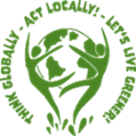
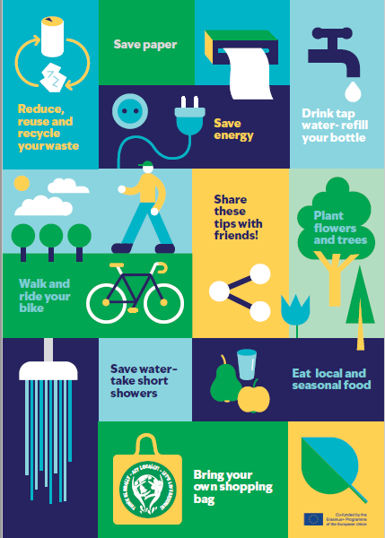
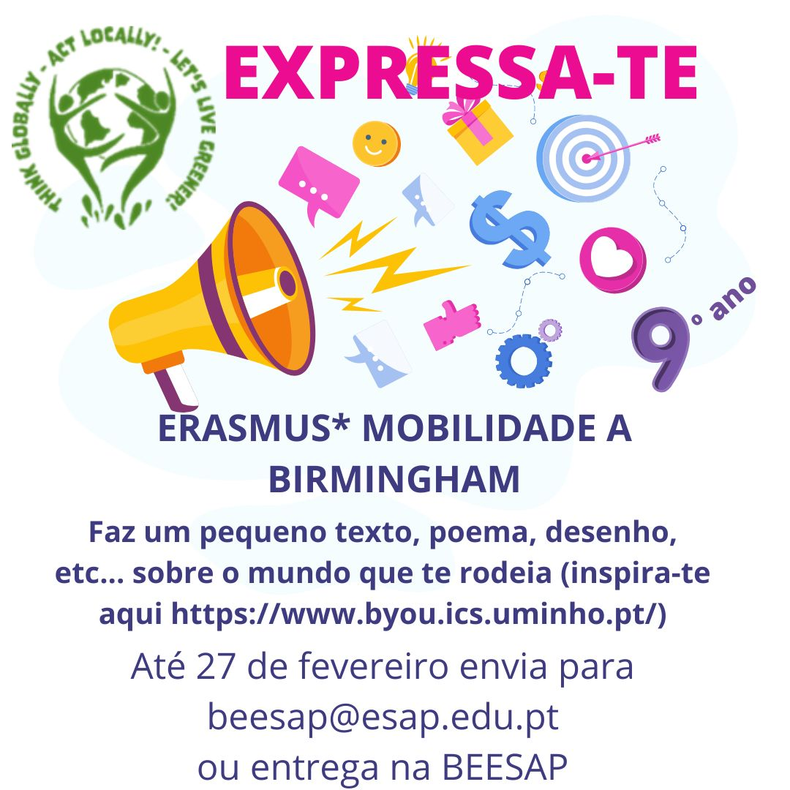
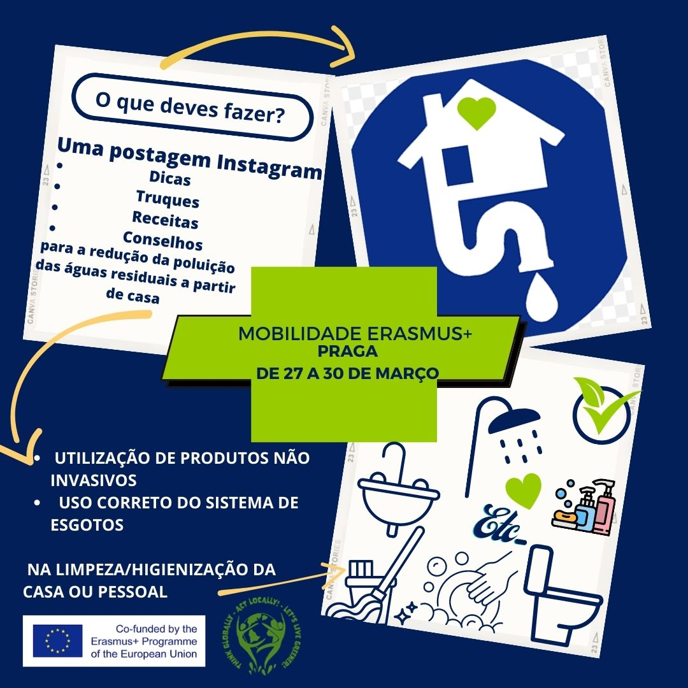
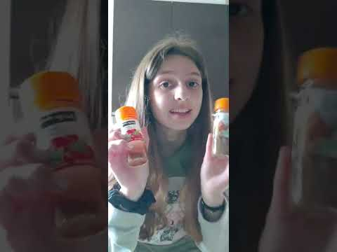
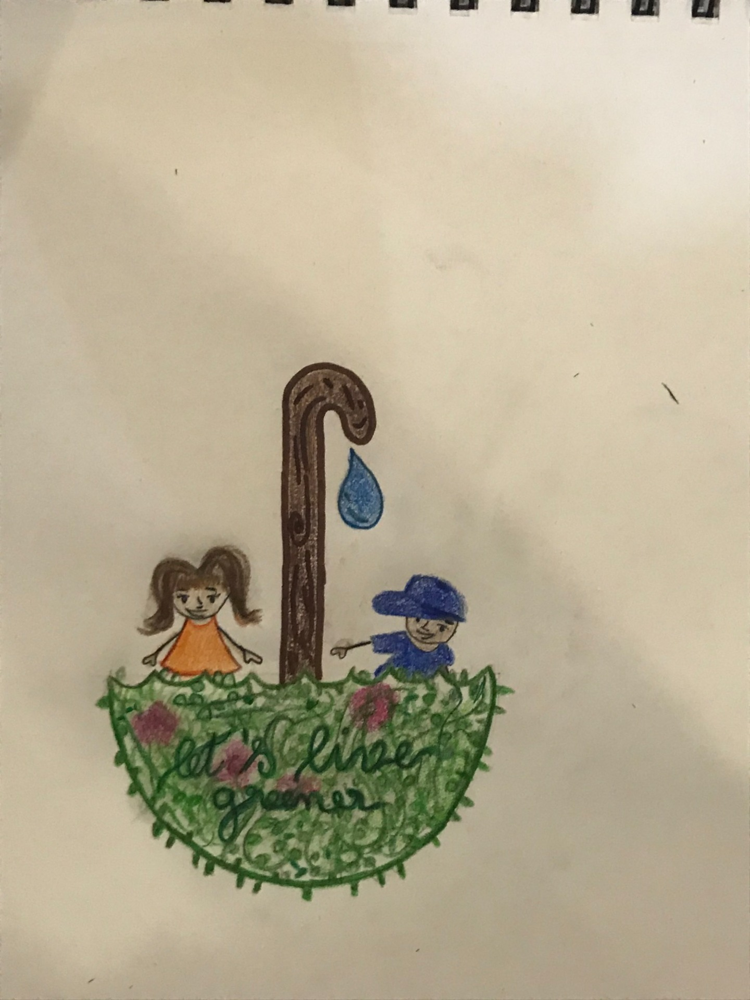

# Projeto Erasmus+ :: Ler o Mundo Na BEESAP

Fonte: arquivo de `wn_projeto-erasmus.html` (recolhido em 2026-11-12)

---

Biblioteca Escolar da Escola Secundária Adolfo Adolfo Portela

## Erasmus+ enriquece vidas e abre horizontes

Hoje foi dia de nova partilha! Recebemos esta semana um grupo de 53 estudantes Erasmus, no projeto TG-BEE ("Think global, learn being an entrepreneur in Europe! [https://tg-bee.my.canva.site/?fbclid=IwAR3yn1gSg7O5ZRzrCOx1DNWOu5S0aqk3d1uj2YlyRwlh_GcTN_Ur8g8wIbc]") Os estudantes de várias nacionalidades (Letónia, Lituânia, Grécia, Itália, Croácia e Portugal) tiveram oportunidade de participar em vários workshops. Este workshop foi dinamizado pela Constança e pela Luana. Explicaram que tinham aprendido a fazer este desodorizante natural aquando de uma das mobilidades a Hamburgo. A "receita" evoluiu conforme os gostos e experiências, no projeto Erasmus+ Think Globally, Act Locally. Let´s live Greener!. As equipas dos vários países tiveram oportunidade de levar com eles um pequenos desodorizante para poder escolher de mudar este pequeno gesto de higiene pessoal, sem produtos químicos e com impacto muito reduzido em termos de embalagem e produtos usados.

Quem disse que o projeto terminou aqui? Aprendemos juntos, trocámos experiências e trabalhámos juntos. Agora começa outra fase, aquela em que fazemos a diferença com a oportunidade que nos foi dada.

Tens algumas ideias que queiras partilhar para "viver mais verde"? Vem falar connosco!

Deodorant Workshop [https://www.canva.com/design/DAFvASQRQq8/view?utm_content=DAFvASQRQq8&utm_campaign=designshare&utm_medium=embeds&utm_source=link] de Constanca Pereira

Todas as histórias, experiências, projetos e fotos podem também ser consultadas no nosso Instagram [https://www.instagram.com/inmy_earth/]:

## Cartaz Final dos trabalhos

Os bons projetos, as boas ideias são para partilhar e disseminar, para que, gota a gota se desenhe um impacto significativo e cresça a consciência ambiental individual e coletiva.

Depois do workshop em Hamburgo sentimos a necessidade de partilhar esta aprendizagem simples, mas em tantos sentidos, significativa. Fazer um produto de higiene corporal como o desodorizante, sem que seja apenas um fim em si mesmo, pode ser o início.

Chegou a última mobilidade do projeto Erasmus+ Think Globally, Act Locally. Let´s Live Greener! Será na Inglaterra, Birmingham e, com toda a certeza, uma experiência inesquecível. Estás no 9º ano e estás interessado em participar? Então concorre! A entrega dos trabalhos acaba no dia 27 de fevereiro, dá a tua voz, desenha ou escreve, mas expressa-te! Não deixes de ver o vídeo [https://www.youtube.com/watch?v=iL4b-MvLu90]inspirador e consultar o mural [https://www.muralbyou.pt/] desta campanha bYou Grita, diz, faz... EXPRESSA-TE!, iniciativa da Universidade do Minho.

Se precisares de esclarecimentos, vem à BEESAP, a tua biblioteca escolar.

## Resultados do desafio!

Mais um desafio superado para estes 6 alunos. Irão participar na mobilidade Erasmus+ a Praga, no mês de março. Sendo que o tema para o trabalho em Praga será a água, foram levados a refletir e a fazer uma postagem Instagram, com o tema da poluição das águas residuais. Estão todos de parabéns, a seleção é sempre difícil! E não se esqueçam do lema, vamos pensar global, agir local, vamos viver mais verde, porque sim, tudo começa em casa!

## Mais uma mobilidade Erasmus+

Estás no 9ºano, preocupado com a sustentabilidade do planeta e queres ir a Praga? Se não queres ver Praga por um canudo, então concorre, este desafio é para ti!!

Até 12 de dezembro deverás fazer uma postagem Instagram, enviando-a para beesap@esap.edu.pt.

A tua postagem deverá dar indicações, dicas, conselhos ou receitas para a redução da poluição das águas residuais a partir de casa. Tudo prático e simples! Aqui fica esta postagem, pode ser que te inspire

## Como foi por cá, a mobilidade?

Nos dias 21, 22, 23 e 24 de novembro recebemos os nossos parceiros no projeto Erasmus+ "Think Globally, Act Locally. Let's Live Greener".

A chuva esteve sempre presente, mas nada moderou o entusiasmo de todos os participantes durantes todas as atividades, oficinas e workshops referentes ao UPCYCLING.

O que é? A técnica do upcycling consiste em, com criatividade, dar um novo e melhor propósito para um material que seria deitado fora, sem degradar a qualidade e composição do material. Um objeto/material que passou pelo upcycle normalmente possui uma qualidade igual ou superior que ao original.

A acompanhar-nos e apoiar-nos, tivemos sempre valiosas parcerias, como a Câmara Municipal de Águeda, a Biblioteca Municipal Manuel Alegre e o Parque Botânico de Vale Domingos, aos quais agradecemos todas as oportunidades de aprendizagem.

Para celebrar o Dia da Floresta Autóctone, plantámos dois carvalhos e colocámos uma placa comemorativa do projeto, com o nome de todas as escolas que vieram nesta mobilidade.

Um projeto de workshop ficou pendente por causa da chuva, mas não ficou esquecido. Em breve saberão, em breve!

Mas o que fizemos em relação à temática?

Mostrámos o que faz da nossa escola, uma Eco Escola.

Mostramos as nossas exposições "Com Quase Nada" de brinquedos (7º e 8ºano em colaboração estreita com as famílias) e os Totens (9ºano), feitos em Educação Visual.

Vimos as Exposição Ilustração e Embalagem e tivemos uma oficina prática na BMMA.

Vimos e tocámos os instrumentos musicais feitos com objetos e materiais "salvos" do lixo, no Instituto da Vinha e do Vinho, com o Bitócas.

Fizemos hotéis de insetos, jardins verticais com paletes e plantações em rolos de papel.

Aqui ficam algumas imagens, só algumas, de alguns momentos, que ficam gravados nas memórias de quem os viveu, como uma aventura humana, acima de tudo.

## Seleção da equipa para a mobilidade... a Portugal!

Está na hora de descobrir e de dar a conhecer o que fazemos por cá em termos de sustentabilidade e de upcycling. Vamos divulgar boas práticas e aprender também.

Estás interessado? Então aqui vai!

As equipas Erasmus+ do projeto estarão cá nos dias 21, 22, 23 e 24 de novembro. No dia 23 de novembro é dia da floresta autóctone [https://florestas.pt/noticias-e-agenda/dia-da-floresta-autoctone-preservar-e-plantar/] (se a esta afirmação respondeste "Santinho!", então está na hora de saber um pouco mais sobre ela e a sua importância, no link associado).

Se já sabes tudo, então sai, mesmo que chova, pois não vais derreter, e investe algum do teu tempo em contacto com a natureza para fazer este Trees Fact Files [https://www.canva.com/design/DAFQUSP90zk/DREx6JY5B_pC2LZUK8cQ3w/view?utm_content=DAFQUSP90zk&utm_campaign=designshare&utm_medium=link&utm_source=viewer], em que vais identificar a árvore, ilustrar com fotos e/ou

desenhos, identificares-te no verso da ficha, trazer uma folha dessa árvore bem

direitinha (numa mica por exemplo) e entregar o conjunto na BEESAP até ao dia 7

de novembro. Em caso de empate serão sorteados os candidatos. Verifica que este ficheiro Trees Fact Files [https://www.canva.com/design/DAFQUSP90zk/9AQHbrs3QrWuUc4-wquQ1g/edit?utm_content=DAFQUSP90zk&utm_campaign=designshare&utm_medium=link2&utm_source=sharebutton] está acessível e editável.

Boa sorte e passeios felizes na floresta!

## Seleção dos alunos para a mobilidade à Grécia

Estes cartazes foram os trabalhos submetidos para a apreciação e seleção dos 6 alunos que se irão deslocar a Larissa, na Grécia.

Subjacente a estes trabalhos está a sensibilização para um olhar mais atento à natureza e reconhecimento da saberes ancestrais, em que as plantas, mesmo aquelas às quais chamamos daninhas, eram a farmácia de quem sabia reconhecê-la e fazer uso delas. São muitas vezes princípios ativos de muitos medicamentos das nossas farmácias.

Cartazes do 2 ao 11 [https://www.calameo.com/books/007110366991a4402f01d]

Publish at Calameo [https://www.calameo.com/]

Cartazes do 12 ao 21 [https://www.calameo.com/books/007110366a0b4a738efcd]

Publish at Calameo [https://www.calameo.com/]

## Mobilidade 3: Vamos à Grécia [https://6gymerasmusplusletslivegreener.blogspot.com/p/blog-page.html]?

Antes de mais, faz uma pequena introspeção...

Sim, pensar dá trabalho e refletir sobre nós próprios, nem sempre é agradável.

O tema do projeto é "Pensar Global, Agir Local. Vamos viver mais verde". Sim, o projeto é divertido, é uma viagem, mas não é um simples passeio de diversão. Deves ter vontade de aprender, de agir e de fazer a diferença. Para isso, deves saber ouvir, escutar e sair da tua zona de conforto.

Então estás pronto? Os teus encarregados de educação deixam e tu queres mesmo ir?

Vamos lá agora saber qual é o desafio que lançamos para formar a equipa de 6 alunos que terão a oportunidade de ir à Grécia de 25 a 30 de setembro, em Lárissa [https://6gymerasmusplusletslivegreener.blogspot.com/p/blog-page.html].

Vê com atenção o vídeo, e mão à obra para fazer o melhor cartaz " Não sou uma daninha".

Prazo de entrega: 7 de junho. Apenas serão considerados os cartazes submetidos por email para regina.gaspar@esap.edu.pt, que sigam todas as indicações dadas no vídeo de divulgação do concurso.

Boa sorte e bom trabalho!

## Desodorizante natural, sim!

Este desodorizante torna um gesto diário de higiene, numa

ação mais amiga do ambiente . A escolha de uma embalagem reutilizável e

produtos de base mais simples reduzem a pegada ambiental deste desodorizante.

Foi o que aprendemos neste workshop, na mobilidade Erasmus+ a Hamburgo.

A técnica dinamizadora apresentou várias alternativas a

produtos presentes e usados nas nossas casas, com o usos de produtos básicos

como a cera de abelhas, barras de sabão preto ou azul, vinagre, óleos essenciais

e bicarbonato de sódio.

Mas voltando ao nosso desodorizante, segue a receita:

3

colheres de sopa de óleo de coco de uma manteiga vegetal ( 2 de manteiga de cacau + 1 de óleo de coco)

2

colheres de sopa de amido de batata ou outro

1

colher de sopa de bicarbonato de sódio

5-10

gotas de óleo essencial (opcional)

Derreta o óleo de coco se este

estiver solidificado, e misture os restantes ingredientes. Verta para dentro do

potinho de vidro com tampa, com ajuda de uma colherzinha. Conserva-se até 2

meses (no verão é melhor conservar no frigorífico se gosta dele mais consistente

para aplicação).

## Workshop: transforma roupa velha em papel

Este workshop foi um dos trabalhos em que todas as equipas se envolveram na escola Stadtteilschule [https://6gymerasmusplusletslivegreener.blogspot.com/p/page-of-germany.html]Horn, em Hamburgo, nesta segunda mobilidade Erasmus+. Todas as equipas dos vários países intervenientes foram convidadas a levar uma peça de roupa usada. Com um processo mecânico, movido por uma bicicleta, a roupa foi transformada em fibras, que voltaram sob a forma de folhas de papel. O processo não é complicado e o papel fica bem bonito. Sabendo que o movimento de fast fashion produz uma excessiva produção de resíduos têxteis que acabam em lixeiras, esta poderá ser uma via para reduzir o impacto deste consumo desenfreado. Só em Portugal são produzidas 200 mil toneladas de lixo têxtil. Para contrariar essa praga, invista em qualidade, peças intemporais, volte a colocar as suas peças de vestuário no circuito de revenda ou dê, mas em primeiro lugar, pense bem se precisa de mais uma peça de roupa no seu roupeiro.

Produtos mais sustentáveis

22-04-2023

Desperdício Alimentar

04-05-2022

O desperdício alimentar é um flagelo. Todos os dias, nas nossas casas, nas cantinas e restaurantes, toneladas de alimentos são deitados a perder, assim como toda a energia e recursos variados para os produzir e chegarem às nossas mesas.

Aproveita, que és lindo!

07-04-2022

É o segundo concurso promovido no âmbito da projeto Erasmus+ Let's Live Greener. Desta vez pode levar-te até Hamburgo, na Alemanha. Não te esqueça que o tema é Sustentabilidade, e que, neste caso específico, coloca em relevo a preocupação com o desperdício alimentar. Pensa nos produtos alimentares que mais sobram em tua casa e grava um vídeo...

Resultados do Concursos de Logos

11-01-2022

## Já é conhecida a equipa que irá participar na primeira mobilidade Erasmus+, do projeto atual. É uma equipa 100% feminina.

Think globally, act locally. Let's live greener!

02-01-2022

## Erasmus+ é um programa educativo europeu para a educação, juventude e desporto da União Europeia, destinado às escolas. O enfoque está na promoção de parcerias escolares transnacionais. Para o nosso novo projeto ambiental, estabelecemos parcerias com escolas na Grécia, Inglaterra, Portugal, Espanha e República Checa. Juntamente com estas escolas,...

Concurso de logos

02-01-2022

## O concurso de logos entre os alunos do 8º ano de escolaridade irá determinar quais os alunos selecionados para a mobilidade a Mataró, em Espanha. Terminou no dia 15 de dezembro.

## Neste Padlet [https://padlet.com/reginagaspar/39yddahu0aua73lg]podes conhecer onde se situam as escolas parceiras do projeto.

---

## Conteúdos incorporados

- https://www.canva.com/design/DAFvASQRQq8/view?embed
- https://view.genial.ly/643eed6942d43d0011d4b3f3
- https://v.calameo.com/?bkcode=007110366991a4402f01d
- https://v.calameo.com/?bkcode=007110366a0b4a738efcd
- https://www.youtube.com/embed/J4YfRGikOcw?wmode=opaque
- https://padlet.com/padlets/39yddahu0aua73lg/embeds/preview_embed
- https://www.google.com/maps/d/embed?mid=1QWuvcwceSHR1xZ4q6iwrUV6ASZ6Hkfdv&ehbc=2E312F

## Ligações

- https://tg-bee.my.canva.site/?fbclid=IwAR3yn1gSg7O5ZRzrCOx1DNWOu5S0aqk3d1uj2YlyRwlh_GcTN_Ur8g8wIbc
- https://www.canva.com/design/DAFvASQRQq8/view?utm_content=DAFvASQRQq8&utm_campaign=designshare&utm_medium=embeds&utm_source=link
- https://www.instagram.com/inmy_earth/
- https://www.youtube.com/watch?v=iL4b-MvLu90
- https://www.muralbyou.pt/
- https://florestas.pt/noticias-e-agenda/dia-da-floresta-autoctone-preservar-e-plantar/
- https://www.canva.com/design/DAFQUSP90zk/DREx6JY5B_pC2LZUK8cQ3w/view?utm_content=DAFQUSP90zk&utm_campaign=designshare&utm_medium=link&utm_source=viewer
- https://www.canva.com/design/DAFQUSP90zk/9AQHbrs3QrWuUc4-wquQ1g/edit?utm_content=DAFQUSP90zk&utm_campaign=designshare&utm_medium=link2&utm_source=sharebutton
- https://www.calameo.com/books/007110366991a4402f01d
- https://www.calameo.com/
- https://www.calameo.com/books/007110366a0b4a738efcd
- https://6gymerasmusplusletslivegreener.blogspot.com/p/blog-page.html
- https://6gymerasmusplusletslivegreener.blogspot.com/p/page-of-germany.html
- https://padlet.com/reginagaspar/39yddahu0aua73lg

## Imagens

