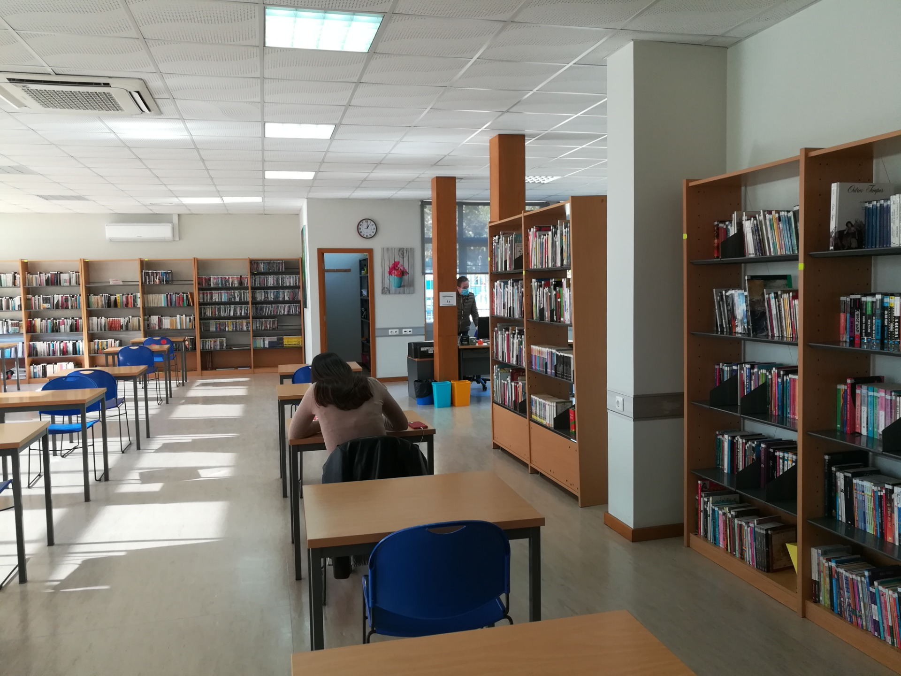

# Quem somos :: Ler o Mundo Na BEESAP

Fonte: arquivo de `wn_quem-somos.html` (recolhido em 2026-11-12)

---

Biblioteca Escolar da Escola Secundária Adolfo Adolfo Portela

A BEESAP apoia o currículo [https://biteable.com/watch/3445564/3259624aac2adbcd315ef2499a161178] on Biteable [https://biteable.com].

A biblioteca escolar, de acordo com o definido no Manifesto da Biblioteca Escolar da IFLA/ UNESCO, "disponibiliza serviços de aprendizagem, livros e recursos que permitem a todos membros da comunidade escolar tornar-se pensadores críticos e pensadores efetivos da informação em todos os suportes e meios de comunicação".

Atendendo ao contexto socioeconómico em que a escola se encontra inserida, a BE assume um papel preponderante na divulgação e promoção da leitura.

Assim, a sua missão será desenvolver hábitos de leitura e promover as três literacias (literacia da leitura, literacia dos media e literacia da informação), de acordo com o Referencial Aprender com as Bibliotecas Escolares, oferecendo a todos os membros da comunidade escolar recursos documentais que desenvolvam o espírito crítico e lhes permitam utilizar eficazmente a informação.

EQUIPA:

Coordenadora: Regina Gaspar

Professores: Isabel Amaro/ Jorge Henriques / Paula Rodrigues/ Sylvie Marques

Assistente operacional: Ana Cláudia Santos

---

## Conteúdos incorporados

- https://biteable.com/watch/embed/3445564/3259624aac2adbcd315ef2499a161178

## Ligações

- https://biteable.com/watch/3445564/3259624aac2adbcd315ef2499a161178
- https://biteable.com

## Imagens

